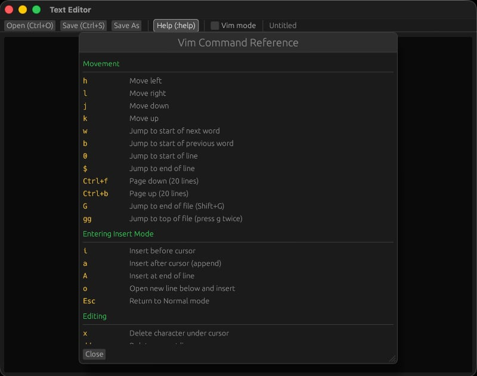

# rust-vim

Simple Rust and Vim GUI editor for learning

Hyper efficient with essential Vim support

Verified working quicky on even a Raspberry Pi 400

Vim toggle and on screen help for learning

Minimal dependencies

Works on Mac and Linux

Run and open file or folders

```
cargo run -- README.md
cargo run -- .
```

Build and open file or folder

```
cargo build --release
sudo cp ./target/release/rust-vim /usr/local/bin/

rust-vim README.md
rust-vim .
```



https://www.egui.rs/
